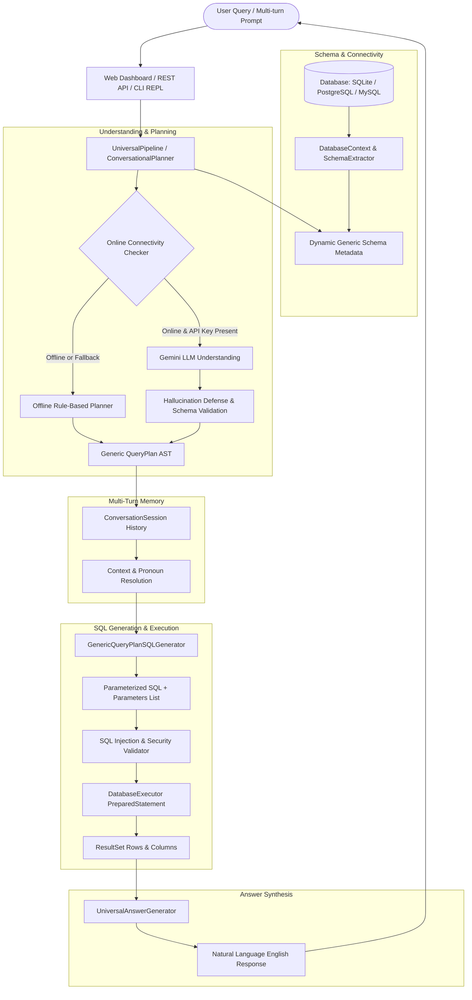

# Universal Natural Language to SQL Pipeline (Java)

A production-grade, multi-database, conversational **Text-to-SQL Pipeline** implemented in pure Java. Converts natural language questions into safe, parameterized SQL queries using an intermediate **QueryPlan** architecture with zero raw-SQL hallucination risk, automated online (Gemini LLM) / offline (Rule-Based) fallback, conversational session memory, evaluation benchmark suites, and an embedded modern Web UI + CLI REPL.

---

## 🏛️ System Architecture



---

## 🚀 Key Features

1. **Intermediate QueryPlan Architecture**:
   - The LLM **never** generates raw SQL strings directly, eliminating SQL hallucination, dialect confusion, and prompt-injection syntax escapes.
   - Outputs a typed, schema-validated JSON QueryPlan (`SUPPORTED`, `AMBIGUOUS`, `UNSUPPORTED`) containing tables, projections, filters, joins, aggregations, groupings, orderings, and limits.

2. **Offline Rule-Based Planner**:
   - Zero-dependency heuristic and rule-based planner that parses schema entities, column references, comparison operators (`>`, `<`, `=`, `between`), and aggregation keywords (`count`, `average`, `highest`, `lowest`).
   - Seamlessly activates when offline, when no API key is configured, or upon network failure.

3. **Advanced Query Capabilities (GROUP BY & HAVING)**:
   - Full support for aggregations: `COUNT`, `SUM`, `AVG`, `MIN`, `MAX`.
   - Dynamic grouping by dimension columns with parameterized `HAVING` filters (e.g., `COUNT(*) > 5`, `AVG(salary) >= 80000`).

4. **Multi-Turn Conversational Memory**:
   - Remembers previous query context in a `ConversationSession`.
   - Resolves conversational follow-ups:
     - *"List all employees in Engineering"* $\rightarrow$ *"What is their average salary?"* (retains table and department filter).
     - *"Sort them by salary descending"* (applies ordering to active result set).

5. **Multi-Database JDBC Abstraction**:
   - Generic JDBC support for any relational database (`jdbc:sqlite:`, `jdbc:postgresql:`, `jdbc:mysql:`, `jdbc:h2:`).
   - Dynamic catalog and table metadata extraction directly from `java.sql.DatabaseMetaData`.

6. **Automated Evaluation Benchmark Suite**:
   - Built-in benchmark harness (`BenchmarkRunner`) testing 20 diverse query categories across multiple test databases (`company.db`, `chemistry.db`).
   - Achieves **100.0% accuracy** on all test suites.

7. **Embedded Web UI & REST API**:
   - Lightweight, zero-external-servlet web server using standard JDK `HttpServer`.
   - Rich, modern glassmorphic dashboard with instant query execution, schema explorer, benchmark runner, and execution timeline visualization.

---

## 📦 Project Structure

```
com.nl2sql
├── answer         # Conversational English answer synthesis (UniversalAnswerGenerator)
├── conversation   # Multi-turn conversation sessions & context resolution
├── database       # JDBC abstraction, dynamic schema discovery, query executor
├── evaluation     # Benchmark test runner, test cases, and scoring metrics
├── generator      # Parameterized SQL generator from QueryPlan AST
├── model          # Generic schema metadata (TableSchema, ColumnSchema, ForeignKey)
├── pipeline       # Universal pipeline orchestrator & interactive CLI REPL
├── plan           # QueryPlan, FilterCondition, HavingCondition, Rule-based planner
├── routing        # Gemini connectivity checker and online/offline routing
├── validation     # SQL validation and injection attack prevention
└── web            # Embedded HTTP server and interactive Web UI
```

---

## 🛠️ Build and Packaging

### Prerequisites
- Java 17+ (Java 21 or Java 26 supported)
- Maven 3.8+ (or included Maven binary)

### Compiling & Running Tests
```powershell
mvn test
```
All **86 automated unit and integration tests** will execute and verify the pipeline components.

### Building Standalone Fat JAR
```powershell
mvn package -DskipTests
```
This generates the self-contained executable uber-JAR:
`target/natural-language-sql-pipeline-1.0-SNAPSHOT.jar`.

---

## 💻 Running the Application

### 1. Launch Web Dashboard (Recommended)
```powershell
java -jar target/natural-language-sql-pipeline-1.0-SNAPSHOT.jar --web --port 8080 --db data/company.db
```
Open [http://localhost:8080](http://localhost:8080) in your browser.

#### Features in Web UI:
- **Interactive Query Console**: Type questions in natural English and see generated SQL, parameter bindings, execution time, and conversational answers.
- **Dynamic Schema Explorer**: View all discovered tables, columns, data types, and primary keys.
- **Benchmark Suite**: Run the 20-case evaluation harness with a single click and review live pass/fail scorecards.
- **Sample Query Quick-Pills**: Test common relational, aggregation, and edge cases instantly.

### 2. Interactive CLI / REPL Mode
```powershell
java -jar target/natural-language-sql-pipeline-1.0-SNAPSHOT.jar --interactive --db data/company.db
```
Commands within REPL:
- `:schema` - Display active database schema tables and columns
- `:db <path>` - Switch active database connection
- `:mode [online|offline]` - Toggle LLM online mode vs offline rule planner
- `:history` - Display recent conversation turns
- `:reset` - Clear conversation memory
- `:help` - Show command help
- `:exit` - Exit the shell

### 3. Direct Query CLI
```powershell
java -jar target/natural-language-sql-pipeline-1.0-SNAPSHOT.jar --query "Show employees with salary greater than 60000" --db data/company.db
```

### 4. Run Evaluation Benchmark Suite
```powershell
java -jar target/natural-language-sql-pipeline-1.0-SNAPSHOT.jar --benchmark
```
Output:
```
=======================================================================
                     EVALUATION BENCHMARK REPORT                      
=======================================================================
Total Test Cases:   20
Passed Cases:       20
Failed Cases:       0
Overall Accuracy:   100.0%
=======================================================================
```

### 5. Inspect Database Schema
```powershell
java -jar target/natural-language-sql-pipeline-1.0-SNAPSHOT.jar --inspect --db data/chemistry.db
```

---

## 🌐 REST API Endpoints

When running in web mode (`--web`), the server exposes the following REST APIs:

### `POST /api/query`
Execute a natural language query against the active database.
**Request Body**:
```json
{
  "question": "Show average salary of employees in Engineering"
}
```
**Response**:
```json
{
  "status": "SUCCESS",
  "question": "Show average salary of employees in Engineering",
  "engine": "OFFLINE (Rule-Based)",
  "sql": "SELECT AVG(e.salary) AS avg_salary FROM employees e INNER JOIN departments d ON e.department_id = d.department_id WHERE d.department_name = ?",
  "parameters": ["Engineering"],
  "columns": ["avg_salary"],
  "rows": [["92000.0"]],
  "rowCount": 1,
  "executionTimeMs": 14,
  "answer": "The average salary of employees is 92,000.0."
}
```

### `GET /api/schema`
Retrieve the full metadata schema of the active database.

### `GET /api/benchmark`
Run the automated benchmark suite and return detailed test reports in JSON.

---

## 🔒 Security & Defense Against Hallucination / Injection

1. **PreparedStatement Enforcement**: Every dynamic value identified in user prompts or filter criteria is extracted into a parameter array (`?`) and bound via JDBC `PreparedStatement`. Raw query concatenation is strictly forbidden.
2. **Schema Whitelisting**: Every column, table, and join condition must match known identifiers in `DatabaseSchema`. Unrecognized tokens are rejected before reaching SQL generation.
3. **Keyword Blocking**: Queries attempting `DROP`, `DELETE`, `UPDATE`, `INSERT`, `ALTER`, or semicolon statement splitting are blocked at the validator layer.
4. **Intermediate Plan Isolation**: Online LLMs are instructed to emit only structured JSON QueryPlans with explicit field names and operations, preventing SQL injection or dialect anomalies from entering the generation pipeline.

---

## 📊 Summary of Completed Phases (1-24)

- **Phase 1-8**: Foundational SQLite support, Dynamic Schema Discovery, Generic Metadata, AST QueryPlan, Initial Rule-based Planner, Parameterized SQL Generator, and JDBC Database Execution.
- **Phase 9-16**: Natural Language Answer Generation, Chemistry Database Integration, Company Database Integration, Gemini LLM Router, Online/Offline Fallback, Injection Defense, Ambiguity Refusal, and Initial Test Suites.
- **Phase 17**: Comprehensive Query Understanding (Supported, Ambiguous, Unsupported) with strict Hallucination Defense.
- **Phase 18**: Universal Pipeline CLI & Full Interactive Terminal REPL.
- **Phase 19**: Advanced Aggregations (`COUNT`, `SUM`, `AVG`, `MIN`, `MAX`), `GROUP BY`, and `HAVING` Clauses.
- **Phase 20**: Natural-Language Conversational English Answer Synthesis.
- **Phase 21**: Multi-Turn Conversational Memory & Pronoun/Context Resolution.
- **Phase 22**: Evaluation Benchmark Suite with 100% Accuracy Scoring across 20 Test Cases.
- **Phase 23**: Multi-Database JDBC Support & Universal Connection Abstraction.
- **Phase 24**: Standalone Uber-JAR Packaging, Embedded Web Dashboard UI, REST API, & Complete Documentation.
